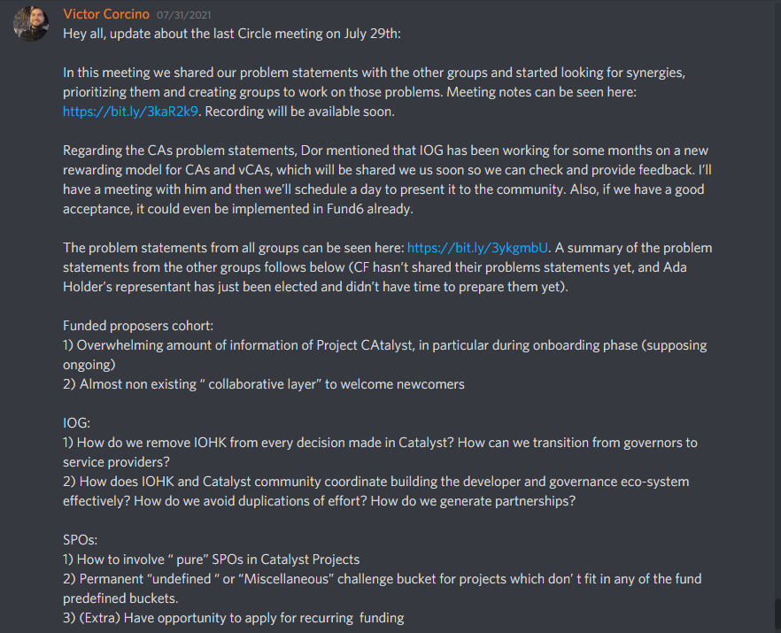

# Community Advisor Circle Activity

## 23rd July 2021 - **P**roblem Sensing Phase ends

### The problem sensing phase about Catalyst from the CAs perspective has just ended.

.png?alt=media)

#### Discord Context



### Rank your vote

.png?alt=media)

.png?alt=media)

.png?alt=media)

## 28th July 2021 - Ranked Voting Results

.png?alt=media)

### Ranked Voting Results

.png?alt=media)

.png?alt=media)

.png?alt=media)

### Round 1

.png?alt=media)

.png?alt=media)

.png?alt=media)

### Round 2

.png?alt=media)

.png?alt=media)

### Round 3

.png?alt=media)

.png?alt=media)

### Round 4

.png?alt=media)

### Round 5

.png?alt=media)

### Ranked Choice Voting!?! Here's How it Works



## 31st July 2021 - Update about Circle Meeting #2

.png?alt=media)

### Transcription

Hey all, update about the last Circle meeting on July 29th:

In this meeting we shared our problem statements with the other groups and started looking for synergies, prioritizing them and creating groups to work on those problems. Meeting notes can be seen here: [https://bit.ly/3kaR2k9](https://bit.ly/3kaR2k9). Recording will be available soon.

Regarding the CAs problem statements, Dor mentioned that IOG has been working for some months on a new rewarding model for CAs and vCAs, which will be shared we us soon so we can check and provide feedback. I’ll have a meeting with him and then we’ll schedule a day to present it to the community. Also, if we have a good acceptance, it could even be implemented in Fund6 already.

The problem statements from all groups can be seen here: [https://bit.ly/3ykgmbU](https://bit.ly/3ykgmbU). A summary of the problem statements from the other groups follows below (CF hasn’t shared their problems statements yet, and Ada Holder’s representant has just been elected and didn’t have time to prepare them yet).

**Funded proposers cohort**: 1) Overwhelming amount of information of Project CAtalyst, in particular during onboarding phase (supposing ongoing) 2) Almost non existing “ collaborative layer” to welcome newcomers

**IOG**: 1) How do we remove IOHK from every decision made in Catalyst? How can we transition from governors to service providers? 2) How does IOHK and Catalyst community coordinate building the developer and governance eco-system effectively? How do we avoid duplications of effort? How do we generate partnerships?

**SPOs**: 1) How to involve “ pure” SPOs in Catalyst Projects 2) Permanent “undefined “ or “Miscellaneous” challenge bucket for projects which don’ t fit in any of the fund predefined buckets. 3) (Extra) Have opportunity to apply for recurring funding

**Toolmakers & Maintainers** 1) Onboarding & Introduction (more details on meeting notes) 2) Trust, Participation, and Reward system(s) (more details on meeting notes)

## 27th August 2021 - CA & vCA Rewarding Model - Project Catalyst Fund 6



### Miro Board Notes - Tevo Saks



### Slides - Victor Corcino



### Tracking - CA & vCA Rewarding Model - Project Catalyst Fund 6



\\
